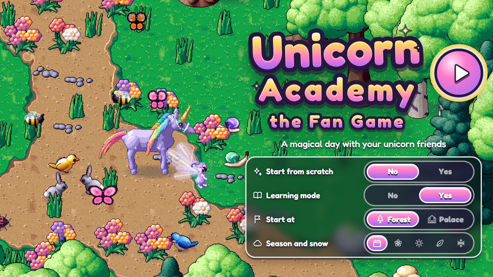
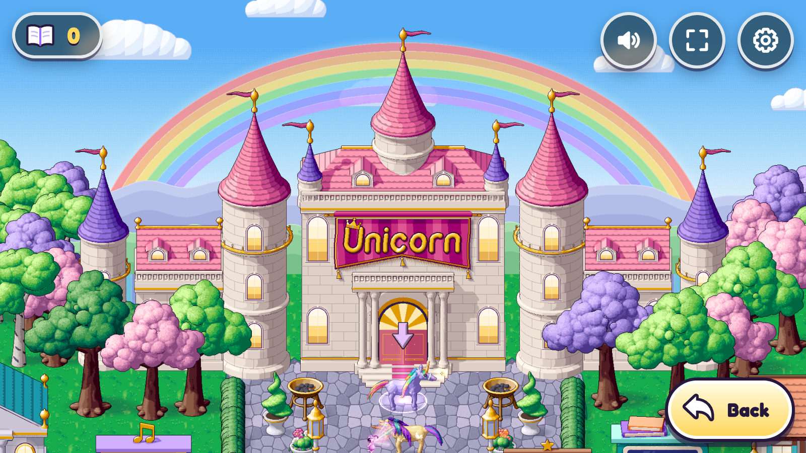
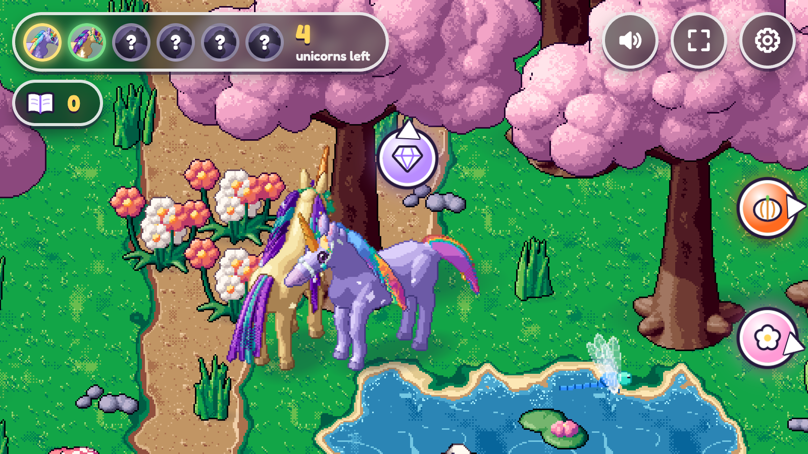
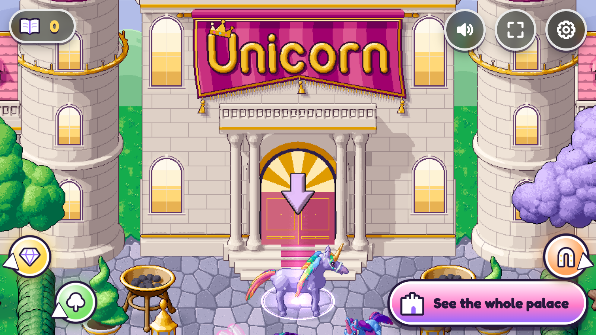
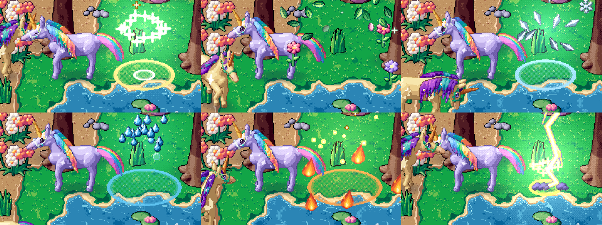

# Unicorn Academy the Fan Game

A free pixel-art game about a herd of unicorn friends. Walk Wildstar through a forest, find five friends, cast their magic, and visit a palace garden with a farm, a pond and an orchard, a throne room, a treasure house, a stable, a playground, a Spooky Manor and a crystal cave. The world goes through the four seasons, with snow in winter.



It runs in any modern browser, installs to the Home Screen, plays offline and keeps its progress on the device. There is no account, no server, no tracking and nothing to buy.

This is an unofficial fan game. It is not made, sponsored or approved by the makers of Unicorn Academy. The name and the characters it is inspired by belong to their owners.

## A look



| | |
|---|---|
|  |  |



The pictures are taken from the running game by `tools/qa/media.ts`.

## Play it

It is live at https://unicorn-academy-game.github.io/. A fork that turns on GitHub Pages publishes a copy of its own, at the address GitHub shows under Settings, Pages. To play it on your own machine:

```sh
pnpm install
pnpm dev
```

Open http://localhost:5173/ and press Play. [`docs/GAME_GUIDE.md`](docs/GAME_GUIDE.md) says what there is to do and how the controls work.

## What is in it

- Six unicorns, each with a magic that changes the props near it: light, nature, ice, water, fire and lightning.
- Nineteen places, a herd that follows you through every door, and critters, fruit, treasure and gems to find.
- Music and ambience that change with the place, all synthesized by the scripts under `tools/audio`.
- Mini-games on the playground and in the manor, including a tone matrix adapted from ToneMatrix Redux.
- Winter games in Santa's grove: dressing a Christmas tree to the last light, and flying the sleigh over a village, with a present for every chimney, on Christmas Eve.
- A Sticker Book that gives a sticker for each good thing a child does, nothing ever asked for or taken away, and a camera that keeps pictures of the herd in an album on the device, where they can be drawn on with crayons and stamps.
- An optional learning mode with a spelling card, a Spell Book, a reading computer with an 85-stage course, a memory table, a maths table that goes from counting to the adding, subtracting, times tables and mixed sums of school, and a writing desk where every letter and number is traced stroke by stroke with a finger. A recorded voice reads every word and sentence.
- Parent controls behind a held button: sound, how each visit starts, learning choices, saving and backups, offline play and recovery.

Almost nothing in it was drawn in an editor. The sprites come from a software 3D renderer written for this project, the maps are written in TypeScript, and the sound is synthesized. [`docs/ARCHITECTURE.md`](docs/ARCHITECTURE.md) says how the parts fit together.

## Status

The automated tests drive the game in Chromium and WebKit at phone, tablet and desktop sizes. They cannot say how it feels in the hand, and no automated check runs on a real iPhone or Fire tablet. If you try it on a device, an issue that says what you saw is welcome.

## How small it is

| | Sent compressed |
|---|---|
| The first playable moment (page, code, the herd, the forest and its sound) | about 4.5 MiB |
| The whole game, kept on the device for play with no connection | about 14.9 MiB |
| The spoken lessons, kept as they are heard or all at once when a parent asks | about 35.1 MiB |

Pictures are lossless WebP, sound is packed at the rate the audio engine plays at, Phaser is a file of its own that a new release borrows from the one before, and the spoken lessons are never part of what a first visit downloads. [`docs/ASSETS.md`](docs/ASSETS.md) says how each number is kept down, and `pnpm build` fails when the build grows past its budgets.

## Commands

You need Node 22.12 or newer (`.node-version` names the one used here) and pnpm 11.22.0, which `package.json` names in `packageManager`.

| Command | What it does |
|---|---|
| `pnpm dev` | Starts the Vite development server on port 5173 |
| `pnpm build` | Validates the assets, builds the game into `dist`, and builds the service worker with the release file list |
| `pnpm preview` | Serves `dist` the way GitHub Pages serves a project site, from a folder, so a path that only works at the root of a site shows up |
| `pnpm smoke` | Plays the finished build in Chromium under that folder, keeps it on the device, goes offline and reloads |
| `pnpm lint` | Checks formatting and lint rules with Biome; `pnpm lint:fix` applies what it can |
| `pnpm typecheck` | Runs `tsc` for the domain, app, service worker and tools projects |
| `pnpm test` | Runs the unit tests |
| `pnpm test:e2e` | Runs the browser tests on a phone, a high-density phone, a desktop and WebKit. Run `pnpm exec playwright install chromium webkit` once first |
| `pnpm assets:build [target]` | Regenerates the runtime assets in `public/assets`. Targets are `all`, `unicorns`, `env`, `npcs`, `maps`, `audio` and `speech`. It needs `ffmpeg`, `lame` and `cwebp`, which `docs/ASSETS.md` explains |
| `pnpm assets:validate` | Checks every asset reference, animation, portal, spawn, anchor, budget and loop. Add `--report docs/ASSET_REPORT.md` to rewrite the report |
| `pnpm notices` | Rewrites `THIRD_PARTY_NOTICES.md` from the installed packages. `--check` fails when it is out of date |
| `pnpm icons:build` | Redraws the Home Screen icons |

Add `?test` to the address to expose `window.__ua`, the handle that the browser tests use to read and steer the game. `?incognito` plays a visit that writes nothing to the device.

## Publishing

The game is a static site. `.github/workflows/pages.yml` checks, builds and publishes it to GitHub Pages on every push to `main`, and nothing else hosts it. Every address in the build is relative, so it works at the root of a site and in the folder of a project site alike. [`docs/DEPLOY.md`](docs/DEPLOY.md) has the steps and what to check.

## Layout

```text
src/shared       ids, the compass of a unicorn's 32 facings, save schemas, manifest types. Pure
src/content      unicorns, props, magic reactions, activities and the reading course, as data
src/domain       the simulation. No Phaser and no browser APIs
src/learning     the spelling and reading engine and the rules of the memory and maths games. No Phaser and no browser APIs
src/game         the Phaser stage, the scene controller, asset loading and the sessions of the learning activities
src/render       views for actors, props and effects, plus camera, depth and shadows
src/input        tap hit testing and gestures
src/audio        the mixer, the music and sound-effect service and the recorded voice
src/persistence  IndexedDB saves, backups, device settings and the Spell Book
src/offline      service worker registration and offline status
src/sw           the service worker
src/ui           the DOM layer: loading, title, parent controls and the learning screens
src/wonder       the mini-games
tools            asset generators, map authoring, build steps, QA tools and the voice generator
tests            unit and end-to-end tests
assets           map sources, audio and voice masters, and review contact sheets
public           generated runtime assets, icons and the web manifest
docs             the architecture, guides, the art bible and the asset report
```

Dependencies point one way, from `shared` to `content` to `domain` or `learning`, and then to the client layers. `tests/architecture/layers.test.ts` fails if a pure layer reaches for the clock, randomness or the browser.

## Contributing

[`CONTRIBUTING.md`](CONTRIBUTING.md) has how to set up, how the tests are organised and how to add a prop, a map, a unicorn, a word or a stage of the reading course. Report a security problem as [`SECURITY.md`](SECURITY.md) says, and be kind, as [`CODE_OF_CONDUCT.md`](CODE_OF_CONDUCT.md) asks.

## Licenses

The code is under the GNU Affero General Public License version 3, in `LICENSE`. The pictures and the music are drawn and played by that code and are under the same licence. The files of the tone matrix are adapted from [ToneMatrix Redux](https://github.com/lupine-dev/ToneMatrixRedux) by Wolfy, which is under the GNU General Public License version 3. They are marked `GPL-3.0-only`, and `src/wonder/games/tonematrix/NOTICE.md` lists them with the licence text in `LICENSES/GPL-3.0-only.txt`.

The game carries Phaser (MIT), zod (MIT), idb (ISC) and the Fredoka typeface (SIL Open Font License 1.1). The spoken lessons were made with Qwen3-TTS (Apache License 2.0), in a voice designed for the game. [`THIRD_PARTY_NOTICES.md`](THIRD_PARTY_NOTICES.md) holds their notices, it is written from the installed packages, a test keeps it current, and the About page of the game shows it.

The name Unicorn Academy and the characters it is inspired by belong to their owners, and the licence of this repository gives no right to them. Ask the owners before you sell anything made from this game.
