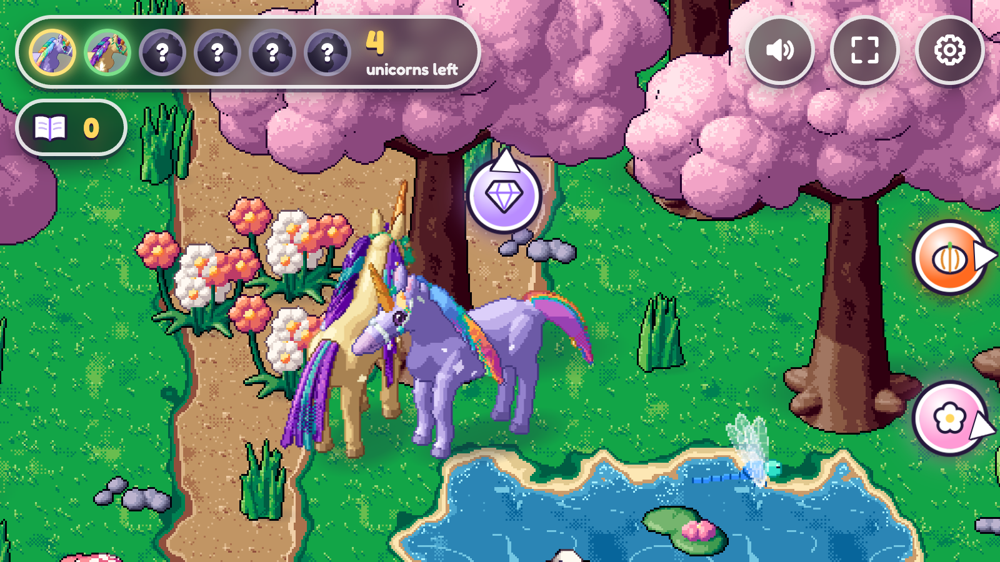
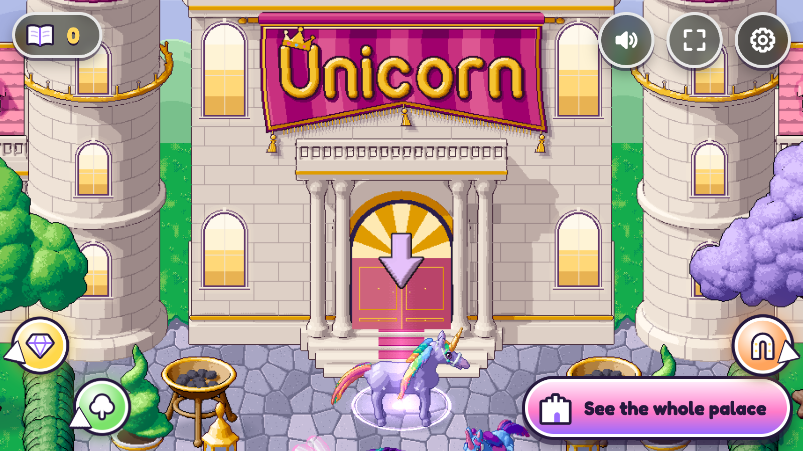
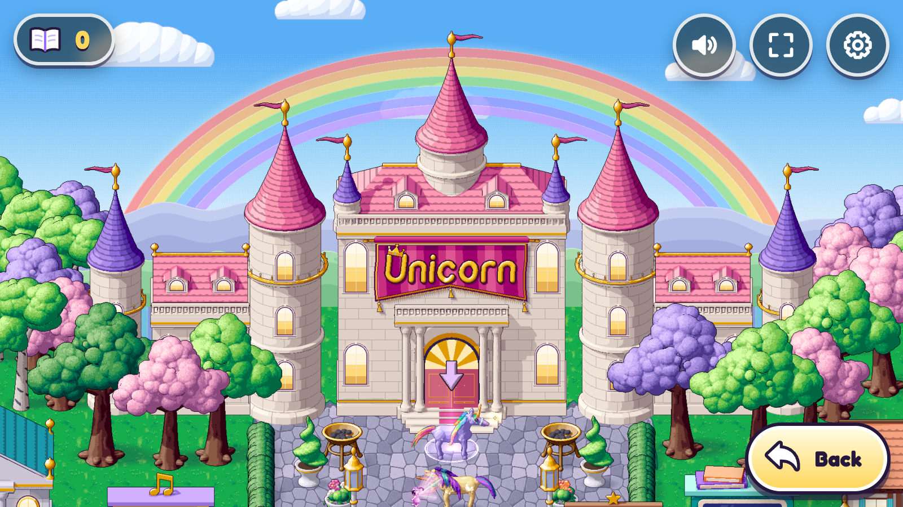
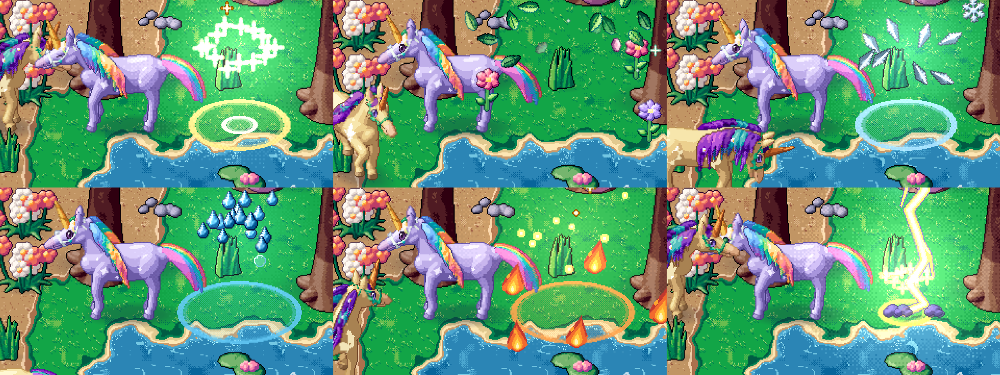

# Art bible

This document says how Unicorn Academy the Fan Game looks, how its pictures and sounds are made, and what a new picture has to do to belong. It is for anyone who adds a unicorn, a place or a prop.

## The look

The game is detailed pixel art seen from a high three-quarter angle, in warm daylight with cool shadows. Characters are drawn with a dark outline, a few clear bands of shade, and one bright catch-light in each eye. Nothing is blurred or scaled by a fractional amount. A unicorn standing in a clearing should look as if she was painted for it, so every ramp in the shared palette leans the same way. Shadows are blue-green or lavender, and highlights are warm yellow.

## How the art is made

Nothing in `public/assets` is hand-drawn in an editor. Each picture is generated by TypeScript under `tools/art`, so a change to a color or a shape is a code change that redraws every frame it touches.

1. Characters, buildings and props are small procedural 3D models, built from lathes, extrusions, arches and meshes in `tools/art/core` and `tools/art/world`.
2. A software rasterizer in `tools/art/core/render.ts` draws each model at four times the final size, with a fixed light, soft ambient occlusion and a depth buffer.
3. Every surface belongs to a material with a ramp of colors. The rasterizer maps light to a band on the ramp, adds an outline on the shaded and the lit side, adds inner lines where surfaces meet, and removes isolated stray pixels. The result is reduced to the final size with hard pixels.
4. Ramps are made in Oklab in `tools/art/core/color.ts`, so a step from dark to light keeps its hue and its apparent brightness.
5. Frames are packed into atlases with two pixels of padding and one pixel of extruded edge, which is what keeps seams out of the picture. The build writes content-hashed files and a manifest.

The unicorn frames are cached under `assets/source/frames`, keyed by a hash of the art code. A frame is redrawn only when something it depends on changes. The environment kit has the same rule per sprite, through the `source` list on each recipe.

Effects and the icons use a small 2D kit (`tools/art/fx/kit.ts`). A shape is a test on continuous coordinates, and a pixel is filled when at least half of it is covered. Fills are cel-shaded from a dome profile, and a dark tone of the fill's own hue closes the shape.

## Scale

| Thing | Size |
|---|---|
| Unicorn frame | 192 by 192 pixels, feet at (96, 156) |
| Side-on unicorn body | about 114 pixels tall |
| Grown-up frame | 200 by 232 pixels, feet at (100, 208) |
| Map tile | 64 world units |
| One world unit | one source pixel |

The camera zoom comes from `chooseView` in `src/render/zoom.ts`. It aims for a body about 103 CSS pixels tall, snaps to a whole number of framebuffer pixels per source pixel when that lands within 16 percent of the aim, and otherwise keeps the aim. On a phone at pixel ratio 1 that is one framebuffer pixel per source pixel. At pixel ratio 2.6 it is two, which draws a body about 87 CSS pixels tall. Both sit inside the 80 to 112 pixel range the game aims for. Wide screens draw slightly larger and show more world.

## The unicorns

The six share one rig and one gait. They differ in coat, markings, mane and tail, halter, horn, eyes and, for two of them, build. At phone size, color, markings, hair and halter carry identity. The official character pages were studied locally for descriptors only. Their images are not in the repository.

| Unicorn | Coat | Mane and tail | Markings | Horn | Eyes | Halter and ornaments |
|---|---|---|---|---|---|---|
| Wildstar | Pale lilac pearl | Full rainbow | White star sparkles, different on each flank | Slender gold spiral | Dark violet, long lashes | White-mint halter, teal gem |
| Leaf | Butter cream | Long violet with teal streaks, tucked daisies | White leaf fans and vines | Copper spiral | Lavender | Green vine halter with leaves |
| Glacier | Silver white, lavender cast | Silver with pink, lilac and teal | Snowflake line art | Periwinkle spiral | Bright blue | White halter, pink noseband |
| River | Azure | Magenta and indigo | Breaking-wave flourishes | Pink pearl spiral | Deep blue | Pink halter, red noseband, silver spiral charm |
| Cinder | Warm terracotta | Red-pink to gold | Golden flame wisps | Rose spiral | Brown | Black halter with silver studs, golden flame charm |
| Storm | Violet slate | Periwinkle | White lightning blaze on the face, bolts on the body | Pale lavender spiral | Amber under a half-lid | Dark halter, silver cheek plate |

The two flanks never carry mirrored markings. Wildstar has different sparkles on each side. Every other unicorn has her motif on the shoulder on one side and on the hip on the other, at different sizes and angles. Storm's blaze is drawn in head space, so it follows every head pose.

**One exception, the two turned-over views, and only until her fine sheets are in.** She walks and stands in 32 facings, every 11.25 degrees. Her first sheet draws eight of them: east, south, west, north, and the slanting views northwest and southwest, which are true three-quarter views at 45 degrees. Northeast and southeast on that sheet are the northwest and southwest frames turned over about her feet, and the manifest marks those clips `flip`. On the turned views her markings come out on the opposite shoulder, and the light falls from the upper right and not from the upper left. The other 26 facings are drawn on two more sheets, which the game brings in after play has begun. Every one of the 32, the six of the first sheet too, is the same model turned about the vertical axis in steps of 11.25 degrees (`facingYaw` in `tools/art/unicorn/model.ts`). Northeast and southeast are drawn there as they are, with the light from the upper left, so once those sheets are in nothing of her is turned over. A device that is given them for Wildstar alone (low-end mode, a Fire tablet, a device that says it has 2 GB of memory) leaves her followers on the turned views for good, and a device that says it has under 2 GB keeps the turned views for all six. The turn gives eight facings from six drawings, and nothing else is turned over. `pnpm assets:validate` fails if a turned clip is not exactly its partner, if a drawn clip is marked turned, or if a picture is not centered on her feet (`tools/assets/check/unicorns.ts`). `tests/e2e/unicorn-flip.spec.ts` draws every turned frame in Chromium and WebKit and compares it, pixel for pixel, with the drawing it comes from, and `tests/e2e/fine-facings.spec.ts` does the same for every picture of every fine sheet. The shadow on the ground is her shadow facing east, turned to the way she is drawn and flattened onto the ground (`src/render/shadow.ts`).

Glacier is slightly finer with a longer neck, and Cinder is slightly sturdier. The other four share one build. The silhouettes are therefore close, and that is a known gap.

The descriptors that the models were written from are in `assets/source/reference/characters.md`.

## Animation

Every clip's timing lives in `src/shared/clips.ts`. The art tools draw exactly those frames, the manifest records them, and the simulation schedules against them.

| Clip | Frames | Per second | Facings | Notes |
|---|---|---|---|---|
| idle | 4 | uneven holds | 32 | Breath, ear flick, tail. Eight facings are on the first sheet, with northeast and southeast turned over, and 26 are on the fine sheets |
| walk | 8 | 12 | 32 | A loop holds two steps. Playback follows speed. Eight facings are on the first sheet, with northeast and southeast turned over, and 26 are on the fine sheets |
| cast | 6 | 10 | 4 | The spell is released on frame 3. Cast from a slanting view, she turns to her side view |
| graze | 6 | 5 | east, west | Head to the ground |
| drink | 6 | 5 | east, west | At a cup |
| signature-idle | 8 | 8 | east, west | A different action for each unicorn |
| rest | 6 | 4 | east, west | |
| stretch | 6 | 6 | east, west | |
| nuzzle | 6 | 6 | east, west | Played by two friends together |

Each unicorn therefore has 484 drawn frames: 172 on her first sheet, where the turned views show 24 of them a second time, and 312 on her fine sheets, which are the walk and the idle of the other 26 facings (12 frames each). The signature action is Wildstar gazing at a mote of light, Leaf sniffing a flower, Glacier stamping a hoof, River splashing, Cinder tossing her mane, and Storm hopping.

The gardener has idle, walk, wave, water, inspect and trim. The stable worker has idle, walk, wave, sweep, carry, brush, pickup and putdown. Each clip is eight frames in four facings.

## Places

| Place | Size | Palette | What is in it |
|---|---|---|---|
| Forest | 64 by 48 tiles | Grass, dirt, water, canopy greens and pinks | Five friend clearings, a pond, flowerbeds, mushrooms, a gate to the palace garden |
| Palace garden | 80 by 64 tiles | Lawn, cobble, warm marble, rose and violet roofs | The palace, rainbow, fountain with two statues and two cups, beds, lantern, brazier, pinwheel, ice display, hedges, the gardener, a fenced farm, an orchard, a pond and an east meadow |
| Treasure house | 24 by 18 tiles | Cream marble, rose carpet, gold | Gold, gems, diamonds, money, two chests |
| Stable | 32 by 24 tiles | Timber, straw, brick | Stalls, crates of fruit, a brushing rail, the worker, boxed unicorns |
| Palace hall | 40 by 18 tiles | Not written down yet | A throne for Wildstar and the hall's furnishings. Look at `tools/maps/author/palace-hall.ts` |
| Playground | 40 by 28 tiles | The garden's tileset and bright toys | Fireworks, cannons, a gem fountain, morph machines, poppers, bubbles, balloons, a slide |
| Manor Wonder Gallery | 40 by 18 tiles | Lilac stone, orange carpet, gold trim | Eight statues on plinths, chandeliers, flower walls, garlands, plum urns, a secret lift |
| Manor Sky Garden | 40 by 18 tiles | Pale green stone, emerald carpet, gold | Gold urns, jewel planters, orchids, crystal tulips, jade bonsai, a lotus fountain, hanging gardens, windows on a twilight forest |

The environment kit has 654 sprites in ten bundles: forest, garden, treasure house, stable, palace hall, playground, manor, effects, creatures (life) and produce. Trees, flowers and buildings are 3D. Ground tiles are made per biome with an edge set, so paths and ponds blend without seams.

**The Spooky Manor** is the one building that is spooky outside and rich inside. Outside it is a dark purple gothic house with crooked towers and glowing orange windows, with friendly jack-o-lanterns that smile, iron lamp posts, low fences, dewy cobwebs, small bats and a twisty tree. Nothing has a scary face, and a ghost may only be a tiny wisp. Inside, the gallery is lilac and orange with gold, and the sky garden is pale green with emerald and gold, so the two floors read as different places. Each statue stands on a plinth and shows a small badge of the place it comes from. The lift door is drawn over the flower wall and slides open when the butterfly is touched. The manor sprites live in the `manor` bundle, and the exterior and yard are in the `forest` bundle.

The palace carries a large crimson banner with "Unicorn" in gold script under a small crown, hung from a rod above the door. The banner sways through twelve frames and has a slow glint. When the herd is near the door, the camera lifts and pulls back just enough to show the banner and the leader together. The only other camera effect in the game is the one for the rainbow below. Both are small and eased, since a game for small children has no dramatic zooms, and reduced effects turns both off.

Wildstar's light, cast from anywhere in the court in front of the palace garden's fountain, brings up a rainbow between the horn tips of the two unicorn statues. Its seven bands arch over the fountain in the colors of the palace door's small rainbow. They paint on from the horns to the apex, shimmer, and then come apart from the apex back to the horns, all in about six and a half seconds. A second cast gives it more time, up to eight seconds in all, and never restarts it. It is drawn as 48 small pieces in the `garden` bundle that the game shows one at a time. Sparkles ride its edge and glitter drifts down from it onto the water. While it stands, the camera lifts to bring the whole arch into view with 24 world units of room above it, and pulls back only on a screen too short to hold the arch and the leader's feet together.

## Effects

There are 37 transient effects, named in `EFFECT_IDS` in `src/content/activities.ts`. Six are the spell bursts, one for each magic. Others are taps, hearts, sparkles, blooms, ice flowers, bubbles, embers, a small cloud, water spray, a door glow, treasure sparkles, a relocate shimmer, the rainbow arc, the sparkles round the rainbow over the palace garden's fountain, three shimmers for a creature that is tapped, and nine for the playground's toys. The game caps live particles at 250, and as a child plays the screen holds 200 at most. The pool holds 480 for a child who taps everything, because the witch's hut with its cauldron and its jars reached 413 alive. Reduced effects thins sparkle density and cloud motion, and interaction feedback stays visible.

## Interface

The page's own controls use Fredoka Variable, bundled with the game so nothing loads from the network. There are two round buttons, sound and the parent gear, and a title with the wordmark and one large Play button. Buttons are at least 48 CSS pixels wide. The parent controls are one sheet with a page for each job, in plain words with no jargon. Safe-area insets keep every control clear of the notch and the home bar.

The Home Screen icon is Wildstar's own head, drawn from her sprite, in a round badge in the wordmark's pink and violet on the title's deep green. `pnpm icons:build` redraws it.

## Sound

All sound is synthesized by the scripts in `tools/audio`, so there are no samples to license. The sound design follows the same rule as the picture, which is that every place has its own mood and nothing is harsh.

| Loop | Length | What it is |
|---|---|---|
| music-forest | 36 seconds | Twelve bars of 4/4 at 80 bpm in C with a lydian lift. Felt piano, harp, flute, celesta and pads |
| music-garden | 36 seconds | Twenty bars of 3/4 at 100 bpm in G. A gentle waltz. Interiors play it quieter and darker |
| ambience-forest | 24 seconds | Wind, leaves, birds |
| ambience-garden | 24 seconds | Fountain, chimes, birds |
| ambience-treasure-room | 16 seconds | Low room tone with soft chimes |
| ambience-stable-room | 16 seconds | Room tone with creaks and hay |
| ambience-manor-yard | 24 seconds | A low night wind, a friendly owl, a gate that creaks, tiny humming wisps and a few bats |
| ambience-manor-hall | 16 seconds | A warm room, a slow clock and a harp that wanders up a quiet scale |
| ambience-sky-garden | 16 seconds | Crickets, a breath of wind, a fountain's drops and the odd far chime |

There are 75 short sounds in three sheets, for steps, voices, magic, doors, chests, cups, tools, the lift's ding and the sound of the manor's word being accepted. Music sits at -20 LUFS, outdoor ambience under it, and the rooms quieter still. `docs/ASSET_REPORT.md` has the measured loudness, true peak and loop joins. Those numbers show the files are the right level and join cleanly. They do not show that the sounds are good, because nobody has listened to them yet.

## How to review art

Look at the real game, not only the generator's preview.

- `pnpm exec tsx tools/qa/shot.ts out.png --play` photographs the running game at a phone size.
- `pnpm exec tsx tools/qa/tour.ts <map> out.png` stitches a whole map, with the interface hidden.
- `pnpm exec tsx tools/qa/zoom.ts` crops a region at a larger scale for checking pixels.
- `pnpm exec tsx tools/qa/fx-film.ts` and `tools/qa/npc-film.ts` lay a moment-by-moment strip of an effect or a grown-up on one sheet.
- The `*-preview.ts` files under `tools/art` draw a turnaround, a clip sheet or a swatch board for one asset.

Check animation frame by frame, not only by one still. Check each unicorn beside the others, and in front of both a dark and a light background.

## Rules for new art

1. Use the shared ramps in `tools/art/world/palette.ts`. Add a ramp there and tune it from a swatch board before using a new color.
2. Keep the lean. Shadows go cool and highlights go warm.
3. Draw at the native scale. Never enlarge a finished sprite by a fractional amount.
4. Give every prop a footprint and a shadow, and give anything tall a canopy region that fades when a unicorn stands behind it.
5. Never mirror a marking from one flank to the other. The northeast and southeast views on a unicorn's first sheet are the one exception, and they are shown only until her fine sheets are in (see The unicorns).
6. Keep state off the sprite. A view can be rebuilt after the graphics context is lost, and the game must not notice.
7. Run `pnpm assets:validate` before looking at the result. It fails on a missing frame, a broken seam, a loop that does not join, or a budget that is passed.

## Known gaps

- The six unicorn silhouettes are close. Two differ in build and four share one.
- Nobody has listened to the audio. The measurements are in `docs/ASSET_REPORT.md`.
- No real phone has shown the art yet. Contrast and size on an actual screen in daylight are pending a test on a real device.
